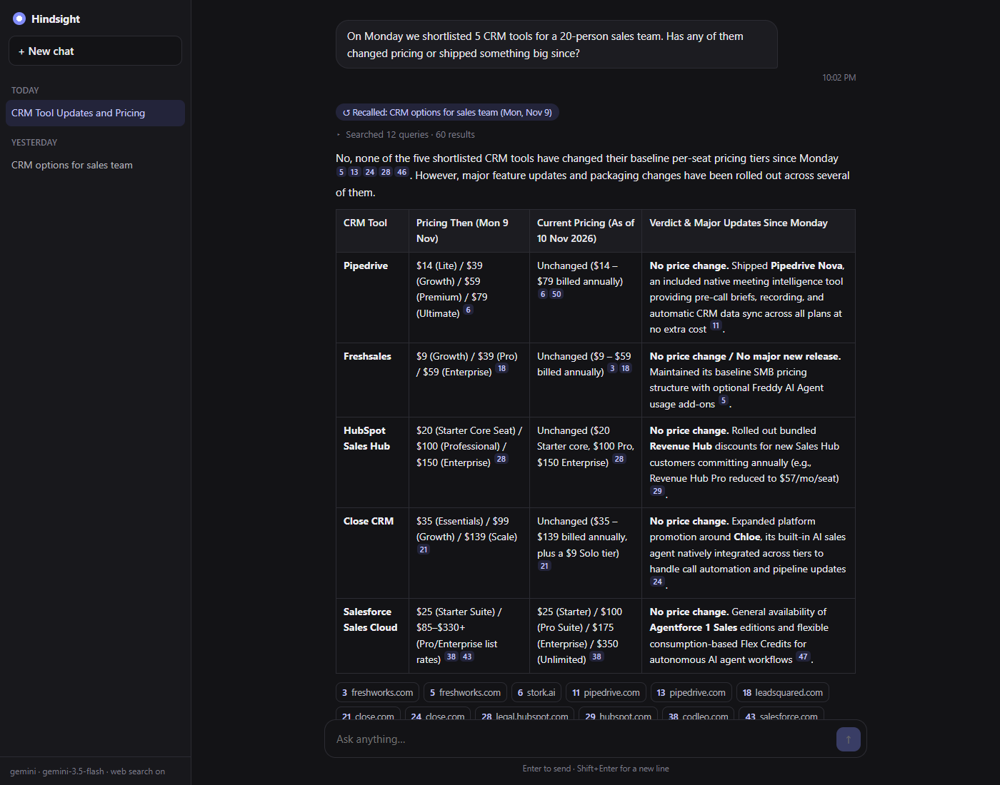
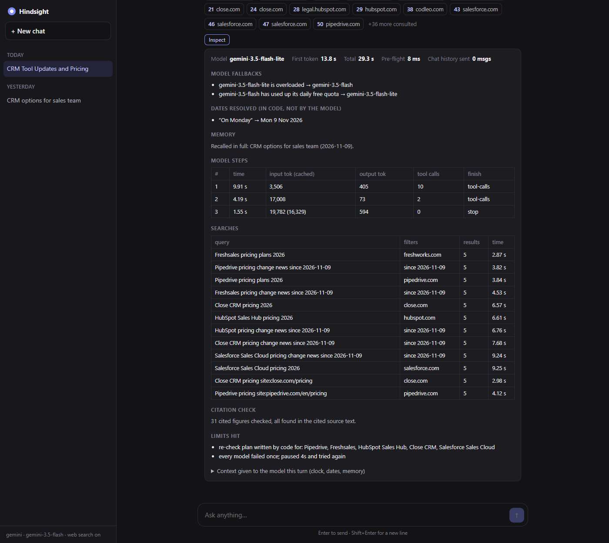

# Hindsight

A chat agent with one tool, **web search**, and a memory of time. It answers with current, cited information, remembers what you discussed, and can re-check its own earlier answers:

> *"Last Tuesday I asked you about Postgres hosting. Has any pricing changed since then?"*
> → recalls the Tue 3 Nov conversation and what it said then, re-reads each vendor's pricing page, searches for announcements since 3 Nov, and answers with a *then vs now* table with a verdict for each item.



Every answer has an **Inspect** button that shows how it was produced: resolved dates, the memory the model was given, model steps with timings and tokens, searches, fallbacks, and a check that every cited figure appears in its source.



*(Both screenshots are from a real `npm run eval` run on the Gemini free tier.)*

The design and the reasoning behind it are in **[DESIGN.md](DESIGN.md)**.

## Run it

```bash
npm install
cp .env.example .env      # then add your keys
npm run dev               # → http://localhost:3000
```

Needs Node 20.3+ (22 LTS recommended). Keys (see `.env.example`):

| Key | What for | Cost |
|---|---|---|
| `GOOGLE_GENERATIVE_AI_API_KEY` **or** `ANTHROPIC_API_KEY` **or** `OPENAI_API_KEY` | The model. The first one set is used; `LLM_PROVIDER` / `LLM_MODEL` override. | Gemini has a free tier |
| `TAVILY_API_KEY` | Web search | Free tier: 1,000 credits/month |

If another provider's key is also set, it's used as a fallback when the main model is rate-limited or down.

Defaults: Gemini `gemini-3.5-flash` · Claude `claude-sonnet-5-5` · OpenAI `gpt-5.5`, each with a cheaper model for background digests. If your key can't use the default model, the app says so; set `LLM_MODEL`.

## Try the memory questions straight away

A fresh install has no history, so memory questions are answered honestly ("I don't have a conversation from 3 Nov on record"). To try a real follow-up without waiting a week:

```bash
npm run seed   # runs two REAL conversations, dated last Tuesday (Postgres) and last Monday (CRMs)
npm run dev
```

Then ask *"Last Tuesday I asked you about Postgres hosting. Has any pricing changed since then?"* Seeded chats are tagged **seeded** in the sidebar.

## Scripts

| | |
|---|---|
| `npm run dev` | Server + UI with reload on change |
| `npm test` | Unit and end-to-end tests with a scripted model (no keys needed) |
| `npm run eval` | Live scenarios from the brief, with time to first token, total time and search counts (`npm run eval -- 3` runs just #3) |
| `npm run seed` | Create real back-dated history for demoing memory |
| `npm run typecheck` | `tsc --noEmit` |

## Layout

```
src/
  server.ts            HTTP + SSE (Hono), static UI
  agent/turn.ts        one turn: pre-flight → agent loop → save → background digest
  agent/answer.ts      the agent loop: streaming, step limits, model fallback and resume
  agent/errors.ts      provider errors → user message, retry or not, how long to rest a model
  agent/history.ts     in-chat history window; message shapes for the browser
  agent/prompt.ts      system prompt (static, cacheable part + dynamic part) and re-check plan
  agent/verify.ts      citation check: cited figures must appear in their source
  memory/recall.ts     memory assembled before each turn: index, by date, by topic
  memory/digest.ts     background summary + claims ledger
  memory/store.ts      JSON store, atomic writes
  search/tool.ts       the web_search tool: citations, dedupe, budget, untrusted fencing
  search/tavily.ts     provider client with retries/timeouts
  time.ts              phrase → exact local days ("last Tuesday" → Tue 3 Nov)
  llm.ts, config.ts    provider selection
public/                no-build UI (vanilla JS, marked + DOMPurify served from node_modules)
test/                  node:test suites
scripts/               eval + seed
```

Data lives in `./data/store.json` (git-ignored). Deleting a chat in the UI also removes it from memory.
